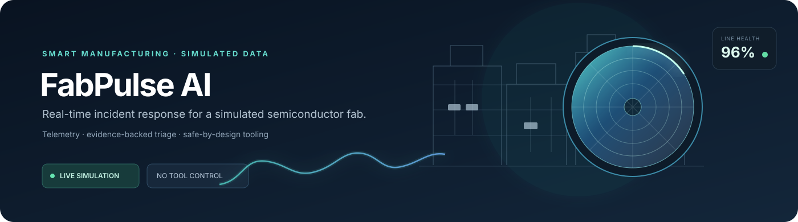
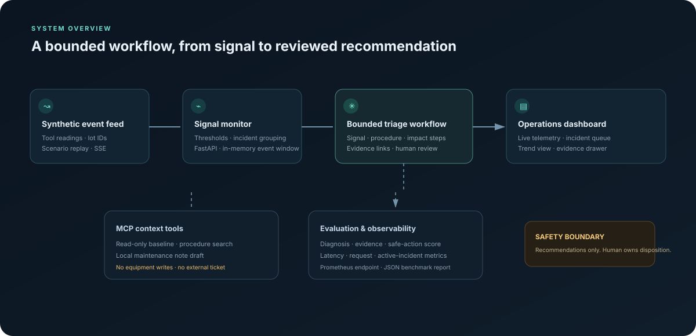

# FabPulse AI

### Real-time incident response for a simulated semiconductor fab

FabPulse watches a stream of equipment readings, spots process drift, and assembles an evidence-backed incident brief for an engineer. It is designed like a small production system: the event stream is live, each finding has traceable evidence, the tools are permission-limited, and every recommendation is evaluated before it is trusted.

> **Demo data only.** FabPulse does not connect to a real fab, factory control system, or Micron system. The simulator creates fictional equipment and lot data so the workflow can be explored safely.



## What you can do

- Watch synthetic tool telemetry arrive in real time and see excursions turn into incidents.
- Open an incident to see the signals, likely cause, confidence, evidence, and suggested next checks.
- Run a bounded triage workflow with separate signal, procedure, and impact steps.
- Ask for a read-only equipment trend or procedure search through the included MCP server.
- Optionally run a Google ADK agent that uses the MCP tools and exposes its agent card over A2A.
- Replay named scenarios and score diagnosis, evidence grounding, action safety, and response time with the evaluation harness.
- Inspect service health and request metrics, then run the app locally or in containers.

## A quick look



The screen uses a dark operations-room palette, compact telemetry cards, and clear severity colors. The UI is plain HTML/CSS/JavaScript served by FastAPI, so the demo has no frontend build step.

## Run locally

Python 3.11 or newer is required.

```bash
python -m venv .venv
source .venv/bin/activate        # Windows: .venv\Scripts\activate
pip install -r requirements.txt
uvicorn app.main:app --reload
```

Open [http://127.0.0.1:8000](http://127.0.0.1:8000). The simulator starts automatically. Use the **Replay scenario** menu to trigger a known excursion, or open an incident and run **Build triage brief**.

To run the MCP server in a second terminal:

```bash
python -m app.mcp_server
```

It uses the MCP Python SDK over stdio and exposes read-only tools for recent telemetry, equipment history, and procedure lookup. The ticket-draft tool returns a draft only; it never connects to a real ticketing system.

### Optional Google ADK agent and A2A endpoint

The dashboard works without model credentials. For a real LLM tool-use path, install the optional agent dependencies, set a Gemini API key, and start the A2A endpoint:

```bash
pip install -r requirements-agent.txt
export GOOGLE_API_KEY="your-key"
uvicorn agent_service.a2a_server:app --host 127.0.0.1 --port 8001
```

The agent connects to the local MCP server over stdio and exposes an A2A agent card at `http://127.0.0.1:8001/.well-known/agent-card.json`. The MCP tool allowlist is explicit. This optional service is separate from the dashboard's deterministic triage endpoint, and it still cannot control equipment or create external tickets.

## Run with Docker

```bash
docker compose up --build
```

The web app is available on port `8000`. The container runs as a non-root user and has a health check.

## Run the evaluation harness

```bash
python -m app.evaluation --scenarios data/evaluation_scenarios.jsonl
```

The harness replays fixed scenarios through the same triage functions used by the API and writes a JSON report to `artifacts/evaluation-report.json`. It reports diagnosis match, evidence coverage, safe-action rate, and elapsed time. These are demo benchmark results, not claims about factory production performance.

## API and live feed

| Route | Purpose |
| --- | --- |
| `GET /api/health` | Readiness and simulator status |
| `GET /api/summary` | Current line summary and key metrics |
| `GET /api/events?limit=40` | Recent telemetry events |
| `GET /api/incidents` | Active and recent incidents |
| `GET /api/incidents/{incident_id}` | One incident with evidence |
| `POST /api/incidents/{incident_id}/triage` | Build a bounded triage brief |
| `POST /api/scenarios/{scenario_id}/replay` | Inject a named demo scenario |
| `GET /api/live` | Server-Sent Events stream |
| `GET /metrics` | Prometheus text metrics |

OpenAPI docs are at `/docs` while the service is running.

## Safety and design choices

- The agent workflow can read telemetry and procedures. It cannot control equipment.
- Any ticket operation is a local draft. The demo never sends a message or changes an external system.
- User-provided notes are treated as untrusted evidence. The workflow uses typed tool inputs, bounded results, and an explicit tool allowlist.
- Recommendations include source references and a confidence label; low-confidence cases ask for human review.
- The live stream and dashboard use generated data. No credentials or private operational data are needed.

## Project map

```text
app/
  main.py             FastAPI endpoints, live stream, metrics
  simulator.py        Synthetic equipment and lot event stream
  triage.py           Bounded investigation workflow and procedure retrieval
  mcp_server.py       MCP tools for read-only factory context and ticket drafts
  evaluation.py       Repeatable scenario evaluation CLI
  static/index.html   Responsive dashboard and event timeline
data/
  procedures.json     Fictional work instructions for the demo
  evaluation_scenarios.jsonl
docs/images/          Repository visuals (SVG)
deploy/k8s/           Single-replica Kubernetes deployment baseline
deploy/examples/      HPA example for a future shared-state version
agent_service/        Optional Google ADK agent and A2A server
```

## Kubernetes

Manifests in `deploy/k8s/` show a single-replica, resource-limited deployment, probes, and a service. The current demo keeps events and incidents in process memory, so the deployment intentionally starts with one replica. `deploy/examples/hpa-after-shared-state.yaml` shows an HPA shape for a later version; add shared event storage and cross-pod stream fan-out before applying it. Update the image name, registry access, and cluster policies for your environment.

## Current scope

The dashboard's triage route uses a deterministic engine so it works without API keys or paid model access. The optional ADK service adds real Gemini tool use through MCP and A2A interoperability. Model serving, GPU inference optimization, and production A2A deployment are not claimed as implemented here.

## License

MIT. See [LICENSE](LICENSE).
